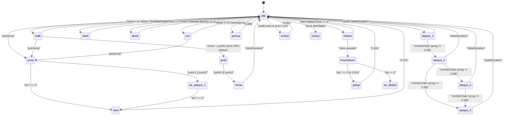

# 03 — Auditoria de Sequências de Animações e Máquina de Estados

## 1. Diagrama da Máquina de Estados (`BeatEmUpScene.ts`)

---

## 2. Problemas Confirmados em Sequências e Transições

### 2.1 Conflito de Leitura em `grab` (Jogador)
- **Local:** [BeatEmUpScene.ts](file:///home/spira/animekombat/src/game/BeatEmUpScene.ts#L624-L668) e `selectActorFrame` ([L1142-L1168](file:///home/spira/animekombat/src/game/BeatEmUpScene.ts#L1142-L1168)).
- **Comportamento observado:** `grab` não está na lista `looping`, e seu `stateDuration` não é inicializado ao entrar em `grab` (permanece o valor residual do estado anterior, ou cai no fallback `0.45s`!). Como o clinch dura até `2.2s`, após `0.45s` a animação trava congelada no **último frame (`F10`, pose de soltura)** enquanto o personagem ainda segura o inimigo e aplica joelhadas invisíveis!
- **Fluxo esperado:** Travar/oscilar nos frames de clinch (`F2..F5`) enquanto segura, disparar explicitamente os frames de joelhada (`F6..F8`) quando `justA1` é pressionado e usar `F9..F10` somente ao soltar.

### 2.2 Congelamento de `knockdown` antes de atingir o chão
- **Local:** [BeatEmUpScene.ts](file:///home/spira/animekombat/src/game/BeatEmUpScene.ts#L696-L707).
- **Comportamento observado:** Ao entrar em `knockdown`, `stateDuration` não é atualizado (`dur` usa valor residual do estado anterior, ex.: `0.34s`), fazendo o sprite avançar rapidamente até `F6`/`F10` (deitado no chão) ainda no meio da parábola aérea, enquanto o corpo continua voando acima da sombra.

### 2.3 Fallbacks Visuais em NPCs (`getup` e `run`)
- **Local:** [BeatEmUpScene.ts](file:///home/spira/animekombat/src/game/BeatEmUpScene.ts#L504-L520).
- **Comportamento observado:**
  - `npc_civil_brasil` e `npc_civil_vermelho` não possuem `getup` no pack; quando levantam após `knockdown`, `getActionFrames` faz fallback para `idle`, causando "teletransporte visual" instantâneo de deitado (`knockdown` F6) para em pé (`idle`).
  - Em `ko_defeat` de `npc_civil_brasil`, o F4 está espelhado na fonte, gerando flip de 180° por ~0.18s durante a queda final.

### 2.4 `land` e `pickup` com Duração Fixa Curta vs 10 Frames
- **Local:** [BeatEmUpScene.ts](file:///home/spira/animekombat/src/game/BeatEmUpScene.ts#L720-L725) (`air_ataque_1` → `land` `0.12s`) e [L979](file:///home/spira/animekombat/src/game/BeatEmUpScene.ts#L979) (`pickup` `0.28s`).
- **Comportamento observado:** Os heróis têm **10 frames** de `land` e **10 frames** de `pickup` (`manifest.json`), mas `selectActorFrame` força `dur = Math.max(0.18, stateDuration)`. Em `0.18s` (ou `0.28s`), passam 10 quadros em ~55 fps ou saltam quadros no meio se o monitor estiver a 60 Hz (`11–17 frames` de tela). Além disso, durante `pickup` (`0.28s`), o jogador fica **travado sem poder mover ou cancelar ataque** ao passar por cima de comida!

### 2.5 Entrada em `ataque_1` durante corrida/ataque e ausência de cadeia de combos `A1`
- **Local:** [BeatEmUpScene.ts](file:///home/spira/animekombat/src/game/BeatEmUpScene.ts#L769-L785).
- **Comportamento observado:** A transição `ataque_1 -> ataque_2 -> ataque_3/4` existe, mas se o jogador apertar apenas `A1` repetidamente (padrão clássico de Beat 'em Up), há uma pausa seca até `idle` e um cooldown de `0.18s` antes de reiniciar `ataque_1`. Além disso, `ataque_2` e `ataque_3` têm janela de cancelamento apenas a partir de `prog >= 0.58` e não aceitam `justA1` durante `dash` (não há *dash attack*).

### 2.6 `victory` em Bosses sem loop contínuo
- **Local:** [BeatEmUpScene.ts](file:///home/spira/animekombat/src/game/BeatEmUpScene.ts#L905) e `selectActorFrame` ([L1142](file:///home/spira/animekombat/src/game/BeatEmUpScene.ts#L1142)).
- **Comportamento observado:** Quando o jogador morre, o Boss entra em `victory` com `stateTime` avançando, mas `stateDuration` pode estar em `0.5s` e após `0.5s` congela no F6 sem reiniciar nem manter pose calma.

---

## 3. Tabela de Durações e Sincronização de Impacto

| Entidade | Ação | Frames | Duração Atual (`BeatEmUpScene`) | Janela Ativa (`prog`) | Sincronização Real |
|---|---|---|---|---|---|
| Herói | `ataque_1` | 10–12 | `~0.34s` (10–12f escalado ~0.50–0.60s) | `0.25 – 0.58` | Coerente (`F3–F7` impacto) |
| Herói | `ataque_2` | 15–16 | `~0.46s` (escalado `~1.0s`) | `0.27 – 0.67` | Coerente |
| Herói | `ataque_3` | 14–20 | `~0.54s` (escalado `~1.1–1.45s`) | `0.35` (projétil) | **Lento para Beat 'em Up** (`1.45s` preso no chão) |
| Herói | `ataque_4` | 40 | `1.45s` (teto do clamp) | `0.35 – 0.75` | `40 frames` em `1.45s` (~27,5 fps efetivos) |
| Herói | `air_ataque_1` | 8–10 | `~0.42s` (escalado `~0.62s`) | `0.22 – 0.78` | Coerente, mas sem janela de recovery pós-pouso |
| NPC | `ataque_1` / `ataque_2` | 6 | `0.54s` / `0.62s` | `0.38 – 0.68` (`F3–F4`) | **Alinhado com F3–F4** dos sheets `3×2` |
| Boss | `ataque_1..4` | 6 | `0.54s`..`0.95s` | `0.38 – 0.68` (`F3–F4`) | **Alinhado com F3–F4**, porém VFX dispara em `0.35` antes de `0.38` |
