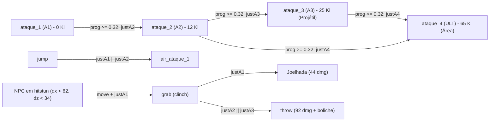

# 05 — Auditoria de Sistema de Combate, Hitboxes e Combos

## 1. Fluxo de Combate Implementado (`BeatEmUpScene.ts`)

---

## 2. Problemas Confirmados em Combate e Hitboxes

### 2.1 **PROBLEMA CONFIRMADO (P1) — Duração de ataques e custo de Ki do `Fighter.ts` (`1v1`) incompatíveis com Beat 'em Up**
- **Evidência:** `BeatEmUpScene.ts` reutiliza `ATTACK_SPECS` de [Fighter.ts](file:///home/spira/animekombat/src/game/Fighter.ts#L61-L149).
  - `ataque_3` tem `cooldown: 2.1s * 0.72 = 1.51s`, `ataque_4` tem `kiCost: 65` e `cooldown: 4.2s * 0.72 = 3.02s`.
  - Mais crítico: `computeActionDuration` (`L542-L546`) multiplica por `frames.length / 6 * 0.88`. Para `ataque_3` (20 frames) isso gera `~1.45s` travado no chão, e para `ataque_2` (15–16 frames) gera `~1.08s` travado! Em um Beat 'em Up com 4 inimigos cercando o jogador, ficar `1.08s–1.45s` sem poder defender/mover torna `ataque_2` e `ataque_3` punições garantidas.

### 2.2 **PROBLEMA CONFIRMADO (P1) — AABB de ataque ignora a altura vertical (`airY`) real da hitbox**
- **Evidência:** Em `performMeleeHitCheck` ([BeatEmUpScene.ts](file:///home/spira/animekombat/src/game/BeatEmUpScene.ts#L989-L1029)):
  - A verificação usa apenas `Math.abs(def.z - attacker.z) > depthTol`, `Math.abs(def.airY - attacker.airY) > 130` e intervalo X `[hitMinX, hitMaxX]`.
  - Não existe cálculo de retângulo `Rect` superior/inferior real: um golpe no chão acerta inimigos quase no topo do salto (`airY = -129`), enquanto um Boss mais alto (`targetBodyHeight = 306`) tem a mesma `defHalfW = 62` independentemente da pose.
  - Em `ataque_4` (`rangeW = 280`), a hitbox continua estritamente **à frente** (`attacker.x - 24` até `+280`) quando `facing = 1` — mesmo que os ultimates (`Genki Dama`, `Bajrang Gun`, `Corte do Mundo`) tenham explosão radial ao redor do herói, deixando inimigos logo atrás (`-30px`) ilesos.

### 2.3 **PROBLEMA CONFIRMADO (P2) — Incoerência de `grab` durante combo e contra inimigos múltiplos**
- **Evidência:** [BeatEmUpScene.ts](file:///home/spira/animekombat/src/game/BeatEmUpScene.ts#L839-L855):
  - `grab` exige que o NPC já esteja em `hitstun` **e** que o jogador aperte `justA1` andando (`Math.abs(input.moveX) > 0.2`). Porém, enquanto o jogador aplica `ataque_1`, ele está no estado `ataque_1`, e ao sair do ataque o `hitstun` do NPC (`0.30s`) frequentemente já expirou antes de o jogador caminhar até `dx < 62`.
  - Além disso, o jogador **não recebe invulnerabilidade nem cancelamento por defesa/pulo** durante `grab` (`2.2s`), ficando vulnerável a golpes nas costas sem poder soltar voluntariamente o clinch.

### 2.4 **PROBLEMA CONFIRMADO (P2) — Projéteis de `ataque_3` sem hitbox real sincronizada ao tamanho do VFX**
- **Evidência:** Em `updateProjectiles` ([BeatEmUpScene.ts](file:///home/spira/animekombat/src/game/BeatEmUpScene.ts#L1003-L1035)), todo projétil (tanto do jogador quanto dos bosses) usa largura fixa `Math.abs(def.x - proj.x) < 58` e profundidade `Math.abs(def.z - proj.z) > 64`, ignorando `frame.meta.w` e sem colisão/clash entre projéteis do jogador e do boss.

### 2.5 **PROBLEMA CONFIRMADO (P2) — `air_ataque_1` só acerta 1 vez e não empurra horizontalmente o jogador em voadora**
- Em `BeatEmUpScene.ts:710-725`, `air_ataque_1` mantém `vx` constante e se `hit` conectar em `prog = 0.22`, os quadros restantes da voadora continuam no ar sem quique de impacto (*bounce*) ou efeito de impacto na aterrissagem.

---

## 3. Modo de Depuração Visual Existente

Foi implementado em [BeatEmUpScene.ts](file:///home/spira/animekombat/src/game/BeatEmUpScene.ts#L1256-L1297) um overlay de depuração ativado pela tecla **`F3`**, exibindo atualmente:
- Linhas pontilhadas dos limites caminháveis `walkMinZ` / `walkMaxZ` (ciano);
- Hurtboxes aproximadas de todos os atores (verde);
- Cruz de âncora no solo `z` (ciano);
- Rótulo de entidade, estado e `z`.

**Lacuna de depuração a completar na Fase D:** O overlay `F3` ainda **não desenha** o retângulo vermelho da **hitbox ativa** durante `ataque_1..4` e `air_ataque_1`, nem o **frame atual (`F3/10`)** ou a **latência do último input**.
